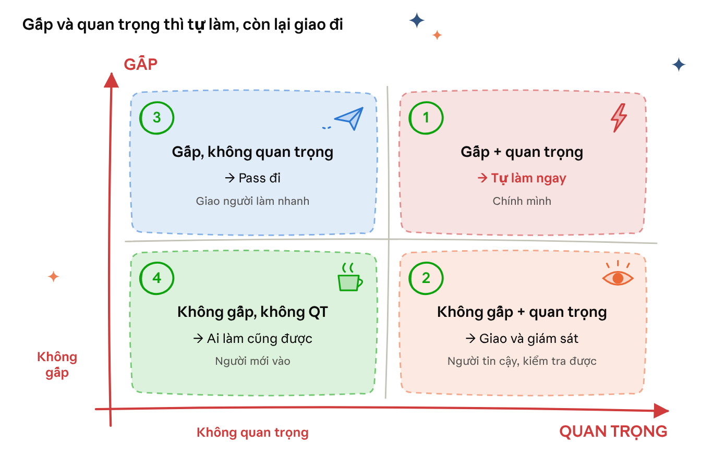

# Recap buổi 1 – Leader Project cần kĩ năng gì?

Masterclass Leader Project Marketing Phim · 18/11/2026 · Khôi

## Tóm gọn

Một leader dự án cần 3 kỹ năng quan trọng: **Plan, Điều phối và Quản lý thời gian**. Trong đó quản lý thời gian là kỹ năng quan trọng nhất, vì thiếu nó thì mọi kỹ năng khác đều đổ: trễ deadline, burnout, mất uy tín.

Nền móng của cả ba là **đối nội vững**: hiểu rõ team mình mạnh gì, yếu gì thì ra ngoài làm việc với khách mới dễ. Buổi học chốt lại bằng vòng **Biết → Hiểu → Làm**: những gì mới học chỉ là *tiền kỹ năng*, phải làm thì mới thành kỹ năng.

## Mindmap kỹ năng

## Highlights

- **Leadership là kỹ năng cá nhân**, bắt đầu từ chính mình trước khi dẫn người khác.
- **Đối nội mạnh thì đối ngoại dễ.** Khách tôn trọng người mang giải pháp, không phải người nói hay.
- **Không có thông tin thì không có plan.** Plan không phải bảng chằng chịt chữ hay cả chục sheet. Plan phải rõ ràng, dễ hiểu: điểm mạnh, điểm yếu, cơ hội, bán cái gì, key point là gì.
- **Giao việc như viết prompt cho AI**: đầu vào tốt thì đầu ra tốt. Brief phải viết đầy đủ thông tin, có ref rõ ràng.
- **Bẫy phổ biến nhất**: thấy gấp là làm, nhầm việc gấp-không-quan-trọng (ô 3) thành việc số 1.
- **Cho nhân sự lớn lên theo lộ trình ô 4 → 3 → 2 → 1**, để họ lên level.
- **Leader tỏa sáng ở khúc nguy cấp**: giống như một người hùng (hero), vào đúng lúc và xử lý được vấn đề. Đây là điều nên học hỏi.
- **Biết và hiểu mà chưa làm thì mới chỉ là tiền kỹ năng.**

## Recap chi tiết

### Mở đầu: leader cần kỹ năng gì khi “bước vào trận”?

Học viên kể: hoạch định, đối nội – đối ngoại, giao tiếp, điều phối, xử lý vấn đề, trách nhiệm. Giáo viên loại “trách nhiệm” ra khỏi danh sách kỹ năng và chốt 3 kỹ năng quan trọng: Plan, Điều phối, Quản lý thời gian.

### 1. Đối nội – Đối ngoại (biết người biết ta)

- Đối nội mạnh = hiểu rõ team: thế mạnh, điểm yếu, ai làm được gì, quá khứ – hiện tại – tương lai.
- Đối nội yếu thì ra ngoài chỉ làm việc với khách theo kiểu may rủi.
- Mọi cuộc nói chuyện với khách nên xoay về thế mạnh của mình (ví dụ của lớp: social, marketing, quay video beauty look).
- Hiểu mình thì có nhiều giải pháp, tự tin khi khách đưa yêu cầu, dám nói không với order không phù hợp.
- Với khách cũng phải xếp ưu tiên: xác định ai là người quyết định (chủ tiệc) là số 1, ưu tiên làm việc với họ.
- Nói hay, thuyết phục là kỹ năng luyện dần qua thực hành.

### 2. Hoạch định (Plan)

- Không có thông tin thì không có plan. Hỏi chủ tiệc, hỏi nội bộ, hỏi bên ngoài.
- Ví dụ buổi tiệc đón khách ở văn phòng mới: hỏi số khách, ai là VIP, quan hệ giữa các khách, ai ăn chay hay kiêng gì, menu, nhạc (chung cư buổi tối nên nhẹ nhàng), phương án trời mưa, backdrop, first impression của văn phòng.
- Hỏi tới khi “nhìn thấy” sự việc trong đầu thì mới dựng được kịch bản A, B, C.
- Đã làm tiệc 40 người không có nghĩa là hiểu tiệc 100 người, vẫn phải hỏi lại.
- Plan để mình hiểu việc mình sẽ làm, dựa vào đó kiểm soát, và nói cho người khác dễ hiểu. Không phải trang trí slide cho đẹp.
- File tracking (data, nhiều sheet) để follow, không phải plan. Plan phải rõ ràng, dễ hiểu: điểm mạnh, điểm yếu, cơ hội, bán cái gì, key point là gì, thách thức, đối thủ ra cùng thời điểm.
- Người làm nhiều năm chưa chắc làm được plan nếu chưa hệ thống lại (master) những gì mình biết.

### 3. Giao việc (điều phối)

- Khi giao phải nói rõ task đó gấp và quan trọng cỡ nào trong dự án. Nhân sự thường không tự phân biệt được.
- Ví dụ của lớp: designer không phân biệt được poster phim quan trọng với một thiết kế chúc mừng sinh nhật, nên ai nhờ gấp là làm trước. Lỗi nặng hơn nằm ở người giao.
- Brief như prompt AI: người mới cần brief dài, kỹ, có reference; người làm lâu chỉ cần brief ngắn.
- Giao xong luôn hỏi “còn gì chưa rõ?”. Người nhận phải hỏi để làm rõ khung trước khi làm, tránh sửa đi sửa lại.
- Leader giữ tiêu chí thế nào là đúng, đẹp, OK và giám sát; không nhảy vào ôm việc để luôn còn thời gian cho việc số 1.

### 4. Quản lý thời gian (quan trọng nhất)

Mỗi ngày liệt kê hết việc (lớn, nhỏ, cá nhân, công ty) rồi xếp vào 4 ô:

| Ô | Loại việc | Xử lý | Giao cho ai |
| --- | --- | --- | --- |
| 1 | Gấp + quan trọng | Tự làm ngay | Chính mình |
| 2 | Không gấp + quan trọng | Giao và giám sát | Người tin cậy, kiểm tra được |
| 3 | Gấp + không quan trọng | Pass đi | Người làm nhanh |
| 4 | Không gấp + không quan trọng | Ai làm cũng được | Người mới vào |

Càng lệch về góc dưới bên trái, việc càng nên giao cho người khác; chỉ ô 1 là leader tự làm.

- Bẫy: thấy gấp là làm không phân loại, hay nhầm ô 3 thành ô 1, cuối cùng việc quan trọng không xong.
- Nếu đã thành thạo: khoảng 850 đầu việc nhưng việc cấp trên giao gấp vẫn xử lý được ngay, vì đã phân loại và giao bớt từ trước.
- Lộ trình phát triển nhân sự: giao ô 4 cho người mới, làm tốt thì lên ô 3, rồi ô 2.
- Công cụ (app, sổ tay, tờ giấy) vô nghĩa nếu không phân loại được. Quản lý thời gian kém thì hao tổn sức, dễ burnout, phải đi chữa lành liên tục.
- Luôn chừa một khoảng trống thời gian (trạng thái available) số 1 → để nhận việc mới, cơ hội mới.

### 5. Biết → Hiểu → Làm → Kỹ năng

- Không biết → hỏi, research → Biết. Biết đủ nhiều → Hiểu. Hai bước này qua lại liên tục: tưởng hiểu rồi lại cần biết thêm.
- Trạng thái đẹp là cân bằng: vừa biết nhiều vừa hiểu rõ. Người làm lâu biết nhiều nhưng chưa chắc hiểu rõ.
- Hiểu mà không làm thì không hình thành kỹ năng. Mọi thứ vừa học (plan, giao việc, thời gian) mới là tiền kỹ năng.

### 6. Case phim: định vị và truyền thông

- Chọn một thể loại dẫn đầu. Phim hành động có cả drama, romance nhưng Action chiếm thời lượng cao vẫn nên định vị Action trước.
- Key message phải đúng chất phim. Ví dụ phim Con Đường Mới phải là “sát thủ, thế giới ngầm, New York – Việt Nam” thay vì “hành trình hoàn lương của gã giang hồ”.
- Poster và teaser đầu tiên tạo ấn tượng đầu: poster dở có thể kéo cả một phim hình ảnh đẹp xuống.
- Bán tên tuổi có sức nặng (diễn viên, DOP, biên kịch có dấu ấn quốc tế).
- Phân tích nhanh trên 1 tờ A4: mạnh, yếu, cơ hội, thách thức, đối thủ ra cùng thời điểm.
- Thay vì dồn tiền cho một reviewer, phủ nhiều KOC/kênh đa ngách (tin tức, giải trí, giới trẻ, âm nhạc, thú cưng, ngôn tình…) để tạo cảm giác ai cũng đang nói về phim.
- Ưu tiên phủ trên TikTok vì phim là video: phân bổ khoảng TikTok 70%, Facebook 30%.
- Team có core vững mới làm được plan vững. Trước khi nhận dự án, nhìn kỹ studio và team; thấy không ổn thì từ chối.

## Phim hoạt hình tóm tắt buổi 1

- ▶ Xem phim online: [https://lethienkhoi.github.io/masterclass-by-Bong/buoi-1/xem-phim.html](https://lethienkhoi.github.io/masterclass-by-Bong/buoi-1/xem-phim.html)
- Bản nhẹ 720p: [phim-xem-nhanh-720p.mp4](phim-xem-nhanh-720p.mp4) (3.9 MB)
- Bản gốc Full HD 60fps để tải về: [phim-leader-project-buoi-1.mp4](https://github.com/lethienkhoi/masterclass-by-Bong/raw/main/buoi-1/phim-leader-project-buoi-1.mp4) (2:45)
- Phụ đề: [phim-leader-project-buoi-1.srt](phim-leader-project-buoi-1.srt)
- Storyboard: [phim-storyboard.jpg](phim-storyboard.jpg)

## Bài tập và ghi chú

- [ ] Bài tập về nhà: liệt kê các thành phần cần có của một plan truyền thông phim.
- [ ] Tự luyện mỗi ngày: to-do list rồi phân vào 4 ô trước khi làm.

---

made by Khoi M1nhon
