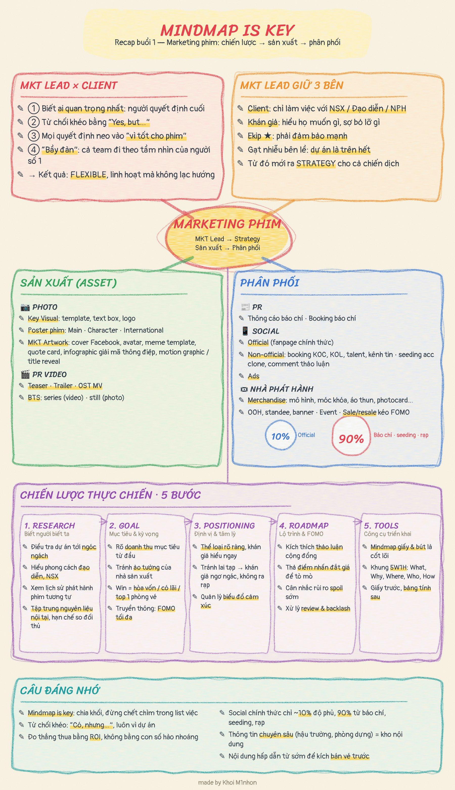
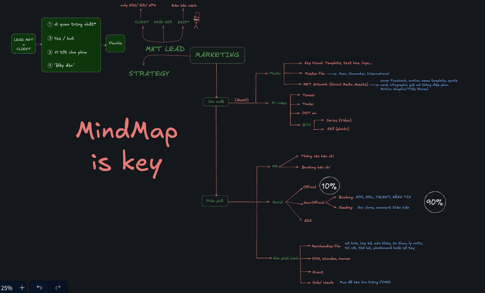
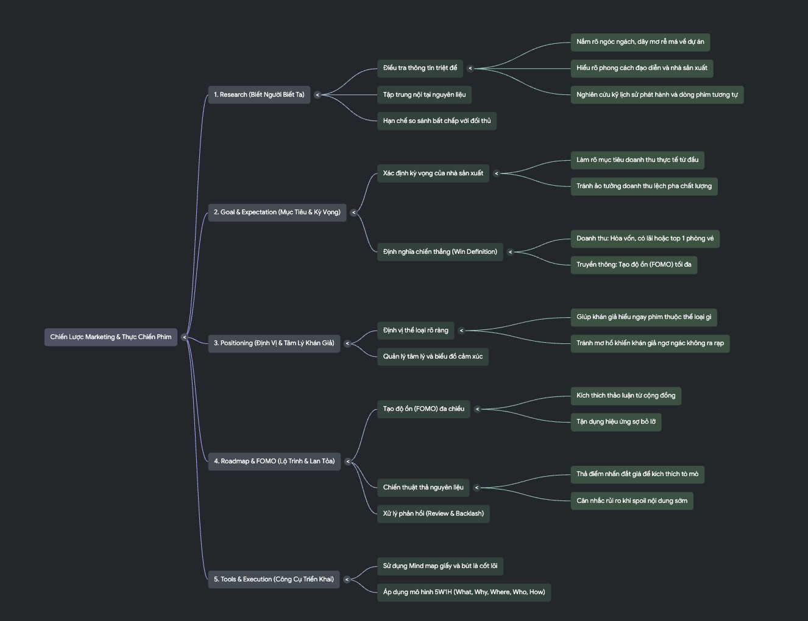

# Recap Buổi 1 – Marketing phim: Mindmap is key

Masterclass Leader Project Marketing Phim · Tổng hợp từ 2 buổi của khóa trước · Khôi

## Tóm gọn

Làm marketing phim cần **tư duy cấu trúc mạch lạc** và **kỹ năng thực thi khéo léo**. Mọi thứ bắt đầu từ một **mindmap**: chia chiến dịch thành các khối rõ ràng (Strategy → Sản xuất → Phân phối) thay vì chết chìm trong danh sách đầu việc.

Người MKT Lead phải xác định đúng **người quyết định cao nhất**, giữ mọi cuộc đàm phán neo vào nguyên tắc **"vì tốt cho phim, dự án là trên hết"**, và hiểu rằng kênh chính thức chỉ là phần nhỏ của câu chuyện: khoảng **10%** độ phủ đến từ social chính thức, **90%** còn lại đến từ báo chí, seeding và các kênh tại rạp.

## Mindmap

## Highlights

- **Cấu trúc ngăn ngừa quá tải**: dùng mindmap chia hoạt động thành các khối chức năng, thay vì list việc dài.
- **Tập trung vào khách hàng số một**: xác định người nắm quyền quyết định cao nhất, gắn cả team với tầm nhìn của họ để gạt bỏ nhiễu bên lề.
- **Nghệ thuật từ chối khéo "Có, nhưng…"**: biến yêu cầu vô lý thành hướng đi tốt hơn, luôn neo vào điều tốt nhất cho dự án.
- **Hiểu độ phủ của kênh**: social chính thức chỉ khoảng 10%; báo chí, seeding bên thứ ba và kênh tại rạp tạo ra 90% còn lại.
- **Thông tin chuyên sâu hơn kiến thức hời hợt**: lịch sử đạo diễn, bí mật hậu trường, thay đổi trong phòng dựng là kho nội dung phong phú.
- **Định nghĩa lại chiến thắng**: đo bằng ROI và định vị chiến lược, không bằng con số hào nhoáng hay ảo tưởng của nhà sản xuất.
- **Thể loại phải rõ ràng**: khán giả hiểu ngay phim thuộc thể loại gì; thể loại lai tạp làm người mua vé bối rối.
- **Điều chỉnh kỳ vọng và FOMO**: nội dung hấp dẫn từ sớm để kích hoạt bán vé trước; tận dụng làn sóng đánh giá trái chiều để đặt lại kỳ vọng và giữ doanh số.
- **Bắt đầu bằng mindmap, không phải bảng tính**: dựng chiến dịch trên khung 5W1H trên một tờ giấy trước khi lập kế hoạch chi tiết.

## Recap chi tiết

### 1. MKT Lead × Client: 4 nguyên tắc

1. **Ai quan trọng nhất**: biết rõ người quyết định cuối cùng của dự án.
2. **Yes / but**: đồng ý trước, rồi đưa ra hướng tốt hơn; từ chối khéo mà không mất lòng.
3. **Vì tốt cho phim**: mọi lập luận và quyết định đều neo vào lợi ích của bộ phim.
4. **"Bầy đàn"**: cả team đi cùng một hướng, theo tầm nhìn của người quan trọng nhất.

→ Kết quả: MKT Lead **flexible**, linh hoạt mà không lạc hướng.

### 2. MKT Lead giữ 3 bên

- **Client**: chỉ làm việc với người có quyền: **nhà sản xuất / đạo diễn / nhà phát hành**.
- **Khán giả**: hiểu họ muốn gì, sợ bỏ lỡ gì.
- **Ekip**: phải **đảm bảo mạnh**, vì ekip là người thực thi toàn bộ chiến dịch.
- Từ ba bên này, MKT Lead mới ra được **Strategy** cho chiến dịch.

### 3. Sản xuất (Asset)

**Photo**
- **Key Visual**: template, text box, logo.
- **Poster phim**: Main, Character, International.
- **MKT Artwork (Social Media Assets)**: cover Facebook, avatar, meme template, quote card, infographic giải mã thông điệp phim, motion graphic / title reveal.

**PR video**
- Teaser, Trailer, OST MV.
- **BTS**: series (video) và still (photo).

### 4. Phân phối

**PR**
- Thông cáo báo chí, booking báo chí.

**Social**
- **Official**: kênh chính thức của phim, chỉ khoảng **10%** độ phủ.
- **Non-official**: booking KOC, KOL, talent, kênh tin; seeding bằng acc clone, comment thảo luận. Cùng với báo chí và rạp tạo ra khoảng **90%** độ phủ.
- **Ads**.

**Nhà phát hành**
- **Merchandise phim**: mô hình, búp bê, móc khóa, áo thun, ly nước, túi vải, thẻ bài, photocard, sổ tay.
- OOH, standee, banner.
- Event.
- **Sale / resale**: mua để kéo lưu lượng, tạo FOMO.

### 5. Chiến lược thực chiến: 5 bước

**1. Research (biết người biết ta)**
- Điều tra thông tin triệt để: nắm rõ ngóc ngách, dây mơ rễ má của dự án; hiểu phong cách đạo diễn và nhà sản xuất; nghiên cứu lịch sử phát hành của dòng phim tương tự.
- Tập trung vào nguyên liệu nội tại của phim.
- Hạn chế so sánh bất chấp với đối thủ.

**2. Goal & Expectation (mục tiêu và kỳ vọng)**
- Xác định kỳ vọng của nhà sản xuất: làm rõ mục tiêu doanh thu thực tế từ đầu, tránh ảo tưởng doanh thu lệch pha chất lượng.
- Định nghĩa chiến thắng: doanh thu (hòa vốn, có lãi hoặc top 1 phòng vé) và truyền thông (tạo độ ồn, FOMO tối đa).

**3. Positioning (định vị và tâm lý khán giả)**
- Định vị thể loại rõ ràng: khán giả hiểu ngay phim thuộc thể loại gì; tránh mơ hồ khiến khán giả ngơ ngác, không ra rạp.
- Quản lý tâm lý và biểu đồ cảm xúc của khán giả.

**4. Roadmap & FOMO (lộ trình và lan tỏa)**
- Tạo độ ồn đa chiều: kích thích thảo luận từ cộng đồng, tận dụng hiệu ứng sợ bỏ lỡ.
- Chiến thuật thả nguyên liệu: thả điểm nhấn đắt giá để kích thích tò mò; cân nhắc rủi ro khi spoil nội dung sớm.
- Xử lý phản hồi (review và backlash).

**5. Tools & Execution (công cụ triển khai)**
- Mindmap giấy và bút là cốt lõi.
- Áp dụng mô hình 5W1H (What, Why, Where, Who, How).

## Tư liệu gốc (mindmap của khóa trước)

---

made by Khoi M1nhon
